<div align="center">


    

**A complete self-hosted virtualization platform — QEMU/KVM VMs, multi-node fleets, snapshots & backups, monitoring & alerting — plus **VNM Shield**: anti-tamper protection, auto-recovery, encrypted backup vault, intrusion detection, an automatic error teller and an independent watchdog — behind a gorgeous aurora UI.**

Fast, single-binary-simple to install, and built for real work: spin up VMs with cloud-init, move them between nodes live, schedule backups, drive consoles from your browser, and watch everything from one dashboard.

[⚡ Install](#-one-click-install-ubuntu--debian-vps) · [✨ Features](#-whats-inside) · [🖼️ Screenshots](#%EF%B8%8F-screenshots) · [🧩 Node agent](#-node-agent-worker-nodes) · [❓ FAQ](#-frequently-asked-questions) · [🛠️ Troubleshooting](#%EF%B8%8F-troubleshooting)

</div>

---

## 📑 Table of contents

- [⚡ One-click install](#-one-click-install-ubuntu--debian-vps)
- [🎛️ Two run modes](#%EF%B8%8F-two-run-modes--pick-at-install-time)
- [🛡️ VNM Shield (v3.0)](#%EF%B8%8F-vnm-shield--the-security-layer)
- [✨ What's inside](#-whats-inside)
- [🖼️ Screenshots](#%EF%B8%8F-screenshots)
- [🔑 Free vs Premium](#-free-vs-premium)
- [🖥️ Requirements](#%EF%B8%8F-requirements)
- [🧩 Node agent](#-node-agent-worker-nodes)
- [⚙️ Configuration](#%EF%B8%8F-configuration)
- [❓ FAQ](#-frequently-asked-questions)
- [🛠️ Troubleshooting](#%EF%B8%8F-troubleshooting)
- [📚 Documentation](#-documentation)
- [🤝 Contributing](#-contributing)
- [📄 License](#-license)

---

## ⚡ One-click install (Ubuntu / Debian VPS)

```bash
curl -fsSL https://raw.githubusercontent.com/nishant1477/vnm-panel3.0/main/install.sh | sudo bash
```

That's it. The installer downloads Node.js 22 LTS, QEMU/KVM and every dependency, sets up a systemd service, opens the firewall port, and prints your auto-generated admin password — all in ~2–5 minutes.

> **Forked or renamed the repo?** Point the installer at your copy:
> ```bash
> curl -fsSL https://raw.githubusercontent.com/<you>/vnm-panel3.0/main/install.sh | \
>   sudo VNM_REPO_URL="https://github.com/<you>/vnm-panel3.0.git" bash
> ```

## 🎛️ Two run modes — pick at install time

| | `systemd` mode (default on VPS) | `standalone` mode |
|---|---|---|
| **Best for** | Normal Ubuntu/Debian VPS | GitHub Codespaces, Docker/LXC containers, shared hosts, anything **without systemd** |
| **Auto-start on boot** | ✅ systemd unit, enabled | ✅ `@reboot` crontab |
| **Auto-restart on crash** | ✅ `Restart=on-failure` | via process supervisor of your choice |
| **Manage with** | `systemctl {status\|restart\|stop} vnm-panel` | `/opt/vnm-panel/vnmctl {start\|stop\|restart\|status\|logs\|upgrade}` |

The installer **auto-detects** systemd and picks the right mode. You can force one:

```bash
curl -fsSL https://raw.githubusercontent.com/nishant1477/vnm-panel3.0/main/install.sh | sudo VNM_MODE=standalone bash
curl -fsSL https://raw.githubusercontent.com/nishant1477/vnm-panel3.0/main/install.sh | sudo VNM_MODE=systemd bash
```

Re-running the installer with the other mode **migrates seamlessly** (your data and settings are kept). `vnmctl` is installed in both modes and always knows which mode is active (`.vnm-mode`).

<details>
<summary><b>Other install methods</b> (manual, offline bundle, upgrade, uninstall)</summary>

```bash
# From an extracted source zip (offline-friendly):
sudo bash install.sh

# From the bundled zip (pre-installed node_modules — no npm install needed):
sudo VNM_SOURCE=./VNM-Panel-v2.4.0-linux-x64-bundled.zip bash install.sh

# Upgrade an existing install (data & settings are always kept):
curl -fsSL https://raw.githubusercontent.com/nishant1477/vnm-panel3.0/main/install.sh | sudo bash

# Uninstall:
sudo bash uninstall.sh            # keeps /opt/vnm-panel data
sudo bash uninstall.sh --purge    # removes EVERYTHING (VM disks too!)
```

**Useful installer flags** (environment variables):

| Variable | Default | What it does |
|---|---|---|
| `VNM_MODE` | `auto` | `systemd` \| `standalone` \| `auto` (auto-detect) |
| `INSTALL_DIR` | `/opt/vnm-panel` | Install location |
| `PORT` | `8080` | Web UI port |
| `VNM_SKIP_QEMU` | `0` | `1` = skip QEMU packages (control-panel-only hosts) |
| `VNM_REPO_URL` | this repo | Clone from a fork / mirror |
| `VNM_BRANCH` | repo default | Install a specific branch |
| `NODE_MAJOR` | `22` | Node.js major version to install |

</details>

---

## 🛡️ VNM Shield — the security layer

v3.0 adds a complete protection, recovery and diagnosis suite **on top of** the existing panel (nothing is replaced):

| | |
|---|---|
| **Anti-tamper** | SHA-256 baselines of every critical file; monitor or enforce (auto-restore from a hash-verified vault); maintenance windows for legit updates |
| **Auto-Recovery** | health checks + controlled restarts of *dependent* services only — circuit breakers stop restart loops; **VMs are never auto-restarted** |
| **Error Teller** | every error classified into plain language with confirmed vs possible causes + a suggested fix; grouped incidents, searchable, exportable |
| **Backup Vault** | AES-256-encrypted, versioned panel backups (code + consistent DB snapshot) with per-file hashes, scheduled restore tests, optional remote copy — **VM disks never in scope** |
| **Intrusion Detection** | SSH brute-force alerts, sshd/sudoers/firewall/systemd/cron watchers, new listening ports, privileged-account changes — alert-only by design, no destructive auto-response |
| **Emergency Mode** | one click: revoke all sessions, block risky admin ops, freeze evidence; root-only CLI recovery code |
| **VM Guardian & Resources** | per-VM QEMU reality checks, disk/inode/memory monitoring before exhaustion, safe cleanup with preview (VM disks un-selectable) |
| **Signed Updates** | ed25519-verified releases with preflight, pre-update backup, automatic rollback |
| **Independent Watchdog** | separate process + own notify channel restarts the panel when it's truly down — and stops itself before becoming a restart-loop machine |
| **Notifications** | Discord · Telegram · generic webhook · real email (built-in SMTP client) — severity thresholds, dedup, secret redaction |

Dashboard: **Admin → VNM Shield**. Full docs: [`docs/VNM-SHIELD.md`](docs/VNM-SHIELD.md) — install, config, recovery procedures, security model.

```bash
# harden the file layer (dedicated service user, read-only code, watchdog sudo):
sudo scripts/lockdown.sh --apply
# independent watchdog:
sudo systemctl enable --now vnm-watchdog
# everything works from the CLI even when the web panel is down:
sudo scripts/vnmctl status · backup · restore · scan · emergency · update · rollback
```

## ✨ What's inside

| Area | Features |
|---|---|
| **VMs** | Create from OS templates (Ubuntu/Debian/Fedora/CentOS/Alma/Arch/Windows), custom ISOs, cloud-init SSH keys, start/stop/restart/clone/delete, bulk actions, tags, autostart-on-boot, VNC console, web-based SSH terminal, RDP (provisioned through the VM's built-in serial console), SFTP file manager |
| **Node Terminal** | Open a real shell on any node (local or remote) straight from the panel — run diagnostics, tail logs, manage services; every command is audit-logged |
| **Networking** | 5 NIC models, NAT & bridge modes, up to 16 custom TCP/UDP port-forward rules per VM (with honest port-in-use checks), MAC management, IP allocation pool with conflict detection, firewall rules with safe defaults |
| **Multi-node** | Built-in Node Agent ("wings") — register worker servers (systemd **or** standalone for containers/Codespaces), create VMs directly on remote nodes, live migration between nodes, maintenance mode, graceful draining, capacity-aware placement, health heartbeats |
| **Snapshots & Backups** | Real `qemu-img` snapshots, full-file backups with SHA-256 checksums, verification, recovery-test-into-clone, cross-node restore, export/import |
| **Automation** | Persistent task queue with progress/retry/cancellation, cron-style schedules (daily / weekly / every N minutes), crash recovery |
| **Monitoring** | Live CPU/RAM/disk charts (zero-dependency canvas), 24h history, threshold alert rules with sustain windows, alert events + acknowledgement, Discord webhook notifications |
| **Security** | Role-based access (**owner / staff / customer**), per-VM ownership, 2FA (TOTP), scoped API keys (`vnmak_…`), audit trail, rate limiting, CSRF double-submit, session rotation, active-session viewer with one-click revoke, request signing |
| **VNM Shield** | Anti-tamper integrity guard, auto-recovery with circuit breakers, automatic error teller + incidents, encrypted backup vault, IDS, emergency lockdown, VM guardian, safe cleanup, signed updates, independent watchdog, 4-channel notifications — see [🛡️ VNM Shield](#%EF%B8%8F-vnm-shield--the-security-layer) |
| **Premium tier** | Auto Backup, Live Migration, Alert Rules, Scheduled Power — unlocked with a license key, enforced **server-side** (keys are only ever stored as SHA-256 digests) |

## 🖼️ Screenshots

<div align="center">

| Login | Dashboard |
|:---:|:---:|
| 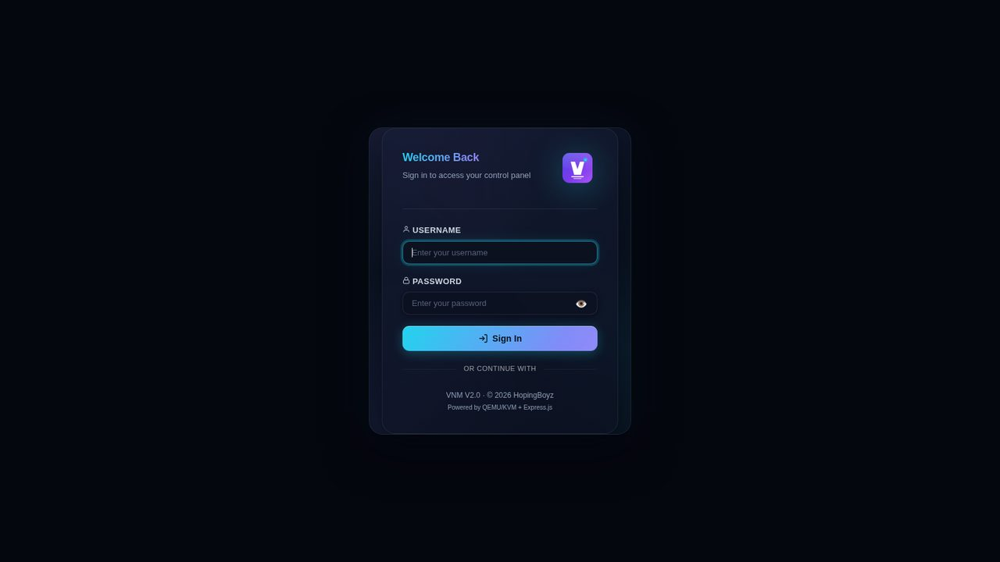 | 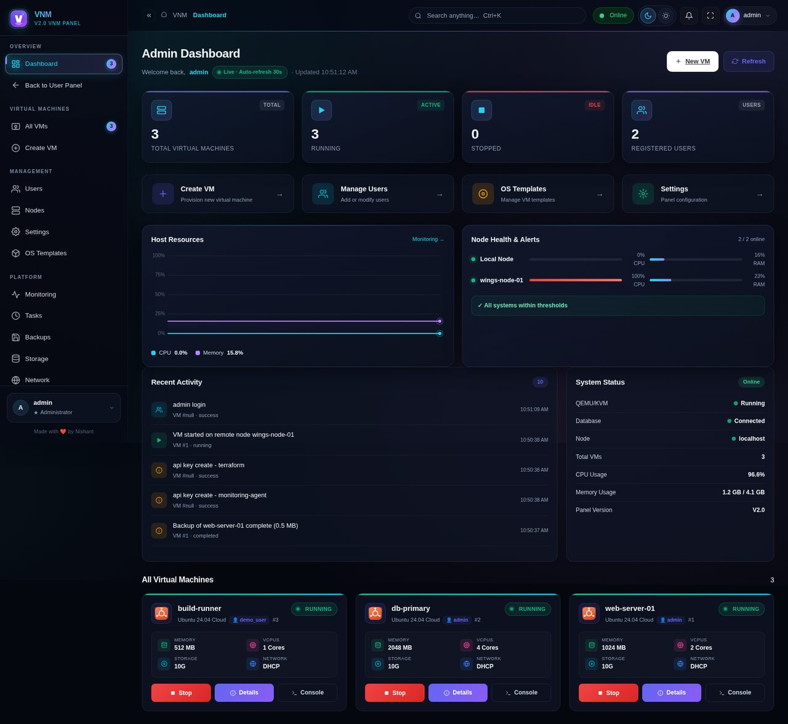 |

| Monitoring | Snapshots & Backups |
|:---:|:---:|
| 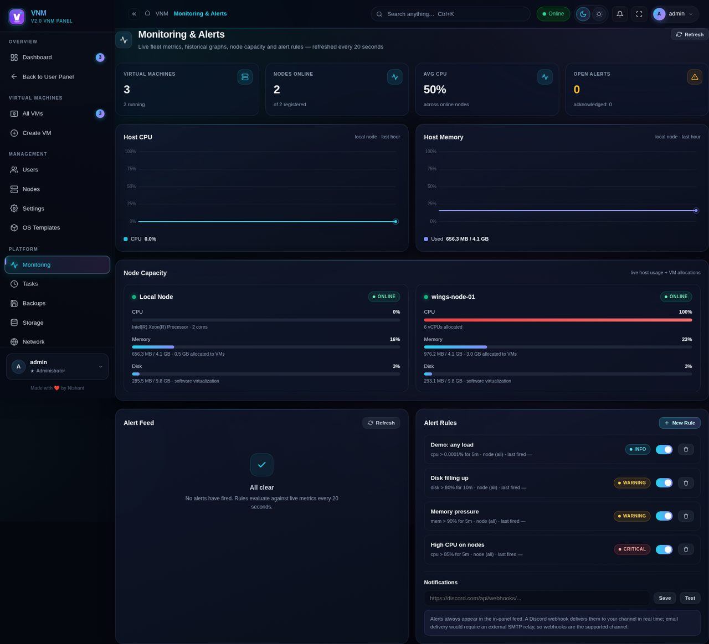 | 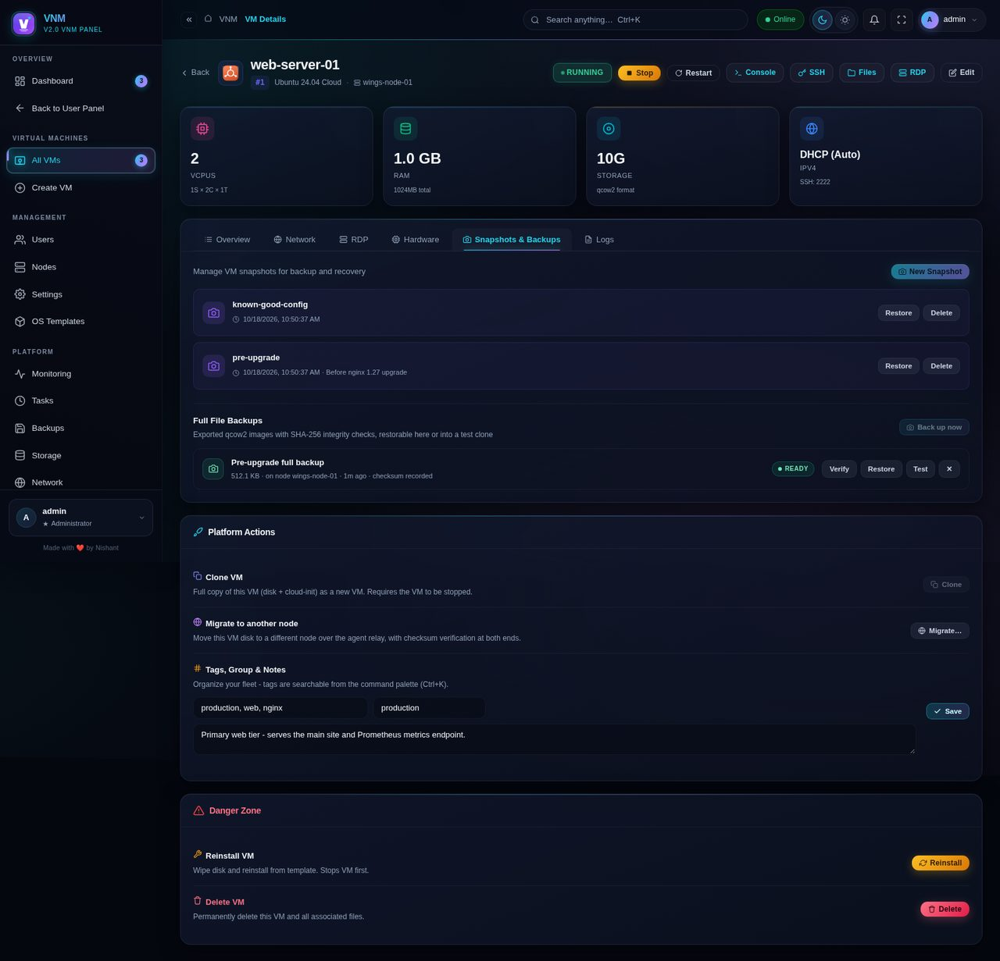 |

| VM Detail | Command Palette (Ctrl+K) |
|:---:|:---:|
| 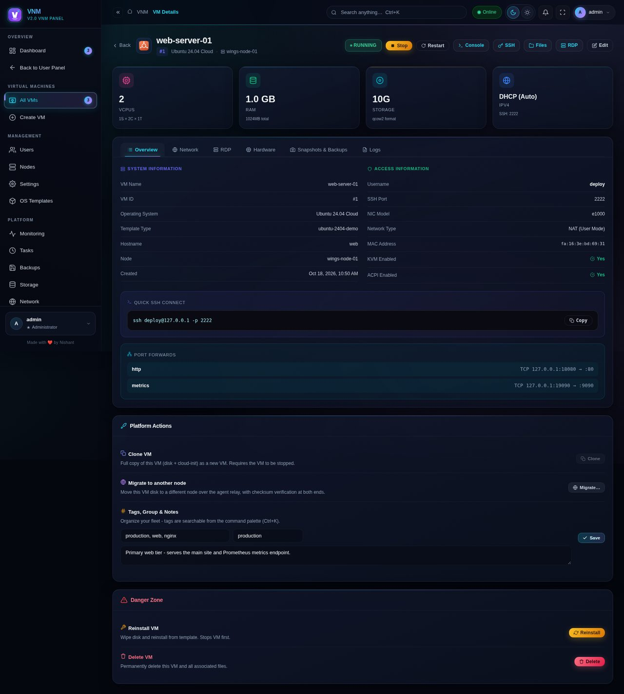 | 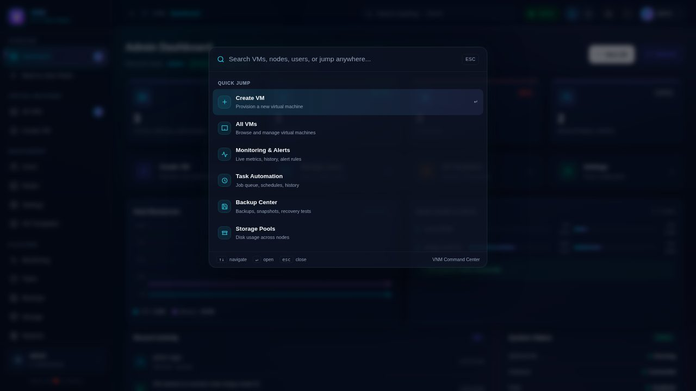 |

| VNM Shield — Overview | VNM Shield — Integrity |
|:---:|:---:|
| 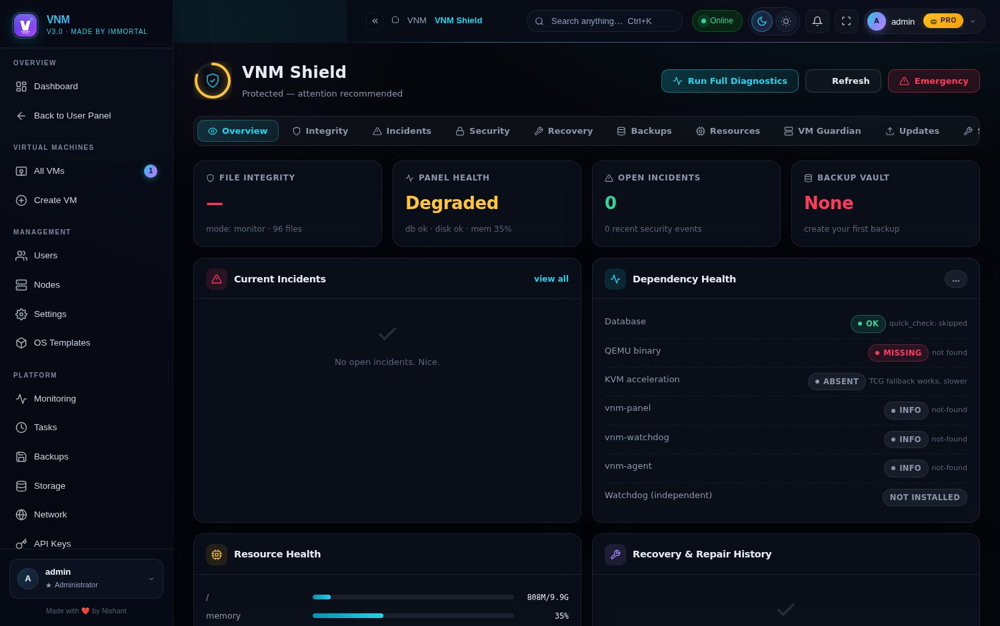 | 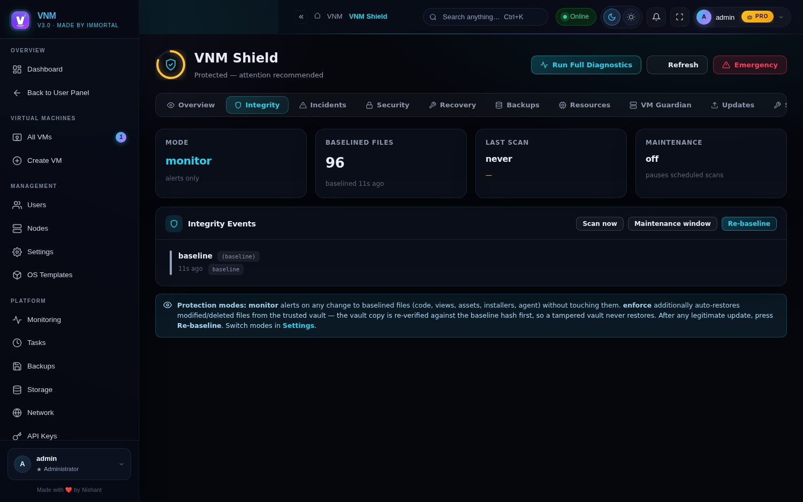 |

| VNM Shield — Recovery | VNM Shield — Backups |
|:---:|:---:|
| 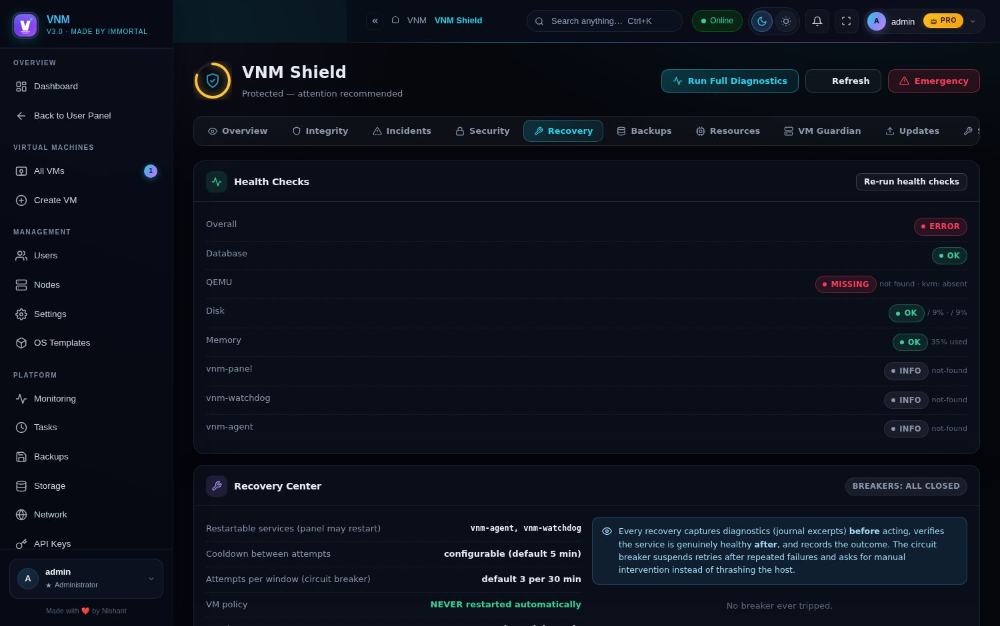 | 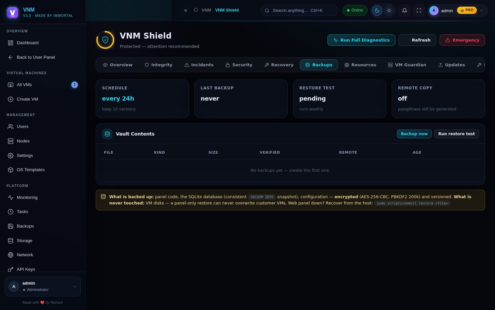 |

| VNM Shield — Security & IDS | VNM Shield — Resources |
|:---:|:---:|
| 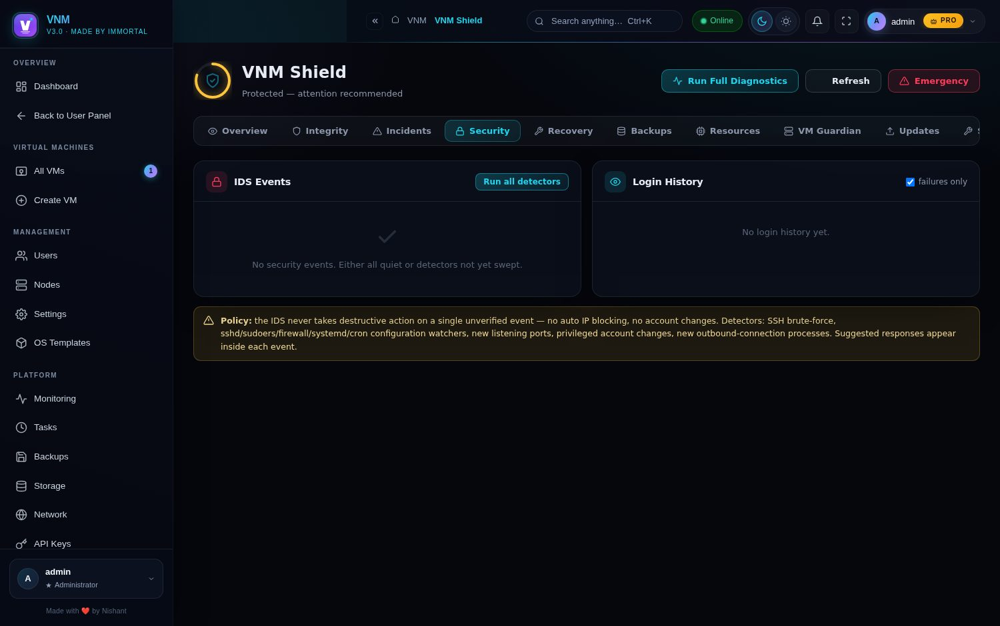 | 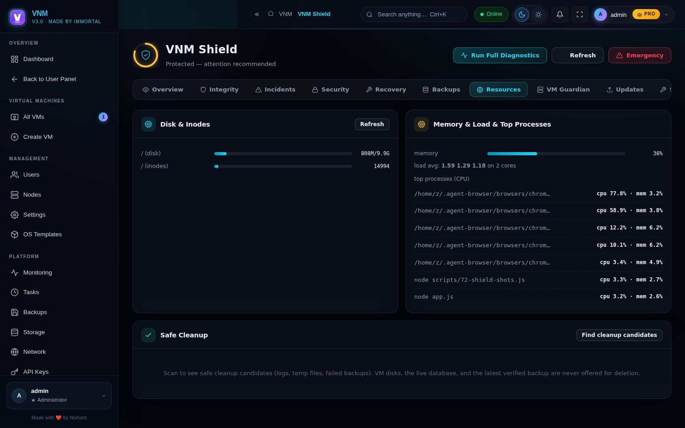 |

</div>

---

## 🔑 Free vs Premium

Everything you need to run VMs is **free forever**. One license key unlocks the power tier:

| Free | Premium (PRO) |
|---|---|
| VMs, console/VNC/RDP/SSH, ISO library | **Auto Backup** — scheduled backups with retention |
| Manual snapshots & backups | **Live Migration** — move running VMs between nodes |
| Users, nodes, firewall, file manager | **Alert Rules** — threshold alerts + Discord webhooks |
| Audit log, API keys, task queue | **Scheduled Power** — auto start/stop/restart |

Click any ✨ PRO feature in the UI and the license dialog opens — enter your key once, it's validated server-side against a SHA-256 digest and never stored or transmitted in plaintext again.

---

## 🖥️ Requirements

- **OS:** Ubuntu 20.04+ / Debian 11+ (fresh VPS works great)
- **RAM:** 1 GB minimum (2 GB+ recommended)
- **Disk:** 5 GB for the panel + space for VM disks
- **KVM:** optional — without `/dev/kvm` VMs run under software emulation (slower but functional, e.g. inside nested VMs; the panel auto-switches to a TCG-safe CPU model)

## 🧩 Node Agent (worker nodes)

Turn any other server into a compute node:

1. Panel → **Nodes** → *Install Agent* (downloads a ready agent package with your panel's token baked in), or follow `node-agent/README.md`
2. The agent registers via websocket, appears ONLINE, and VMs can then be **created directly on that node** with real SSH access (cloud-init seed built on-node)
3. The agent installer runs in **systemd mode** on normal servers and **standalone mode** (nohup + `@reboot` crontab + `vnmagentctl` manager) on GitHub Codespaces, Docker containers and other no-systemd hosts
4. Migrate VMs between nodes live from the UI, or open a **Node Terminal** and drive the node's shell directly

## ⚙️ Configuration

Everything lives in `/opt/vnm-panel/.env` (auto-generated on install):

| Variable | Default | Purpose |
|---|---|---|
| `PORT` | `8080` | Web UI port |
| `VNM_DATA_DIR` | `/opt/vnm-panel/data` | Database location |
| `PANEL_NAME` | `VNM` | Branding shown in the UI |
| `SESSION_SECRET` | random | Cookie signing key — keep it secret |
| `DISCORD_CLIENT_ID/SECRET` | empty | Enable Discord OAuth login + linking |
| `SMTP_*` | empty | Email alerts for monitoring |

After editing: `sudo systemctl restart vnm-panel` (or `vnmctl restart` in standalone mode).

---

## ❓ Frequently Asked Questions

<details>
<summary><b>Someone tampered with my panel files — how do I recover?</b></summary>

Open **Shield → Integrity** — every change against the trusted baseline is listed with old/new hashes. Press **Restore** to put a file back from the hash-verified vault, or switch protection mode to *enforce* to have this happen automatically. If the web panel itself is broken: `sudo scripts/vnmctl scan` then `sudo scripts/vnmctl restore-file <path>` from the host.
</details>

<details>
<summary><b>Can the panel recover itself if it crashes?</b></summary>

The **independent watchdog** (a separate OS service with its own config and notify channel) polls `/api/health`, restarts the panel when it is genuinely down, verifies it came back healthy, and stops after 3 attempts per hour — then it alerts you that manual intervention is required, because an endless restart loop would only mask the real failure. Your VMs are never touched: a panel problem never restarts customer VMs.
</details>

<details>
<summary><b>What exactly gets backed up by the Backup Vault — and what never does?</b></summary>

Vault backups contain panel code, a consistent SQLite snapshot (via `VACUUM INTO` — the running panel is never blocked) and configuration, encrypted with AES-256 and versioned with per-file SHA-256 manifests plus weekly end-to-end restore tests. **VM disks are never in the archive and can never be overwritten by a panel-only restore.** Full disaster-recovery guide: `docs/VNM-SHIELD.md` §5.
</details>

<details>
<summary><b>Do I need KVM for this to work?</b></summary>

No — but it helps a lot. With `/dev/kvm` (most VPSes have it) VMs run at near-native speed. Without it, the panel automatically falls back to software emulation (TCG) with a safe CPU model, which works fine for testing but is ~10–20× slower. Check yours with `egrep -c '(vmx|svm)' /proc/cpuinfo` — `0` means no KVM.
</details>

<details>
<summary><b>Does it run on GitHub Codespaces / in a container without systemd?</b></summary>

Yes. Run the installer with `VNM_MODE=standalone` and it uses `nohup` + an `@reboot` crontab + a `vnmctl` manager script instead of systemd — designed exactly for Codespaces, Docker containers and LXC hosts. The node agent has the same standalone mode.
</details>

<details>
<summary><b>Where do I find my admin password after install?</b></summary>

It's printed at the end of the installer output **and** written to the first boot log: `journalctl -u vnm-panel | grep -A1 "Default admin"` (systemd) or `grep -A1 "Default admin" /opt/vnm-panel/panel.log` (standalone). Change it from **Settings** after your first login.
</details>

<details>
<summary><b>Can I run Windows VMs?</b></summary>

Yes — upload a Windows ISO, create a VM with it attached, and finish setup through the browser VNC console. Note Windows needs decent CPU/RAM (4 GB+ RAM recommended) and runs best with KVM.
</details>

<details>
<summary><b>How does RDP work? Do I need to set up SSH inside the VM?</b></summary>

No sshd needed. **Enable RDP** drives the VM's built-in serial console: it logs in with the VM credentials you set at creation, installs the RDP/xrdp stack inside the guest, and wires up the port forward automatically. If the guest is slow to boot, the panel retries patiently and shows real progress instead of a generic timeout.
</details>

<details>
<summary><b>Which ports does the panel use?</b></summary>

`8080` (web UI, configurable via `PORT`) is the only one you must expose. Everything else stays local or on the node: SSH port-forwards are auto-allocated from `2222` upward, VNC is proxied through the panel's websocket (never exposed directly), and agents dial **out** to the panel over `443`/`8080` — so worker nodes can sit behind NAT.
</details>

<details>
<summary><b>Where is my data stored? How do I back up the panel itself?</b></summary>

Everything lives under `/opt/vnm-panel` — the SQLite database in `data/vnm.db`, VM disks in `~/vms` (or the node's `vms/` dir). Back up those two paths and the `.env` file and you can restore the whole panel on a fresh box. VM-level backups/snapshots are built in and schedulable.
</details>

<details>
<summary><b>How do I upgrade?</b></summary>

Re-run the installer — it detects the existing install, keeps your database, settings, users and VMs, and restarts the service. `vnmctl upgrade` does the same in standalone mode. No SQL migrations to run by hand; schema changes are applied automatically on boot.
</details>

<details>
<summary><b>Can the panel and VMs be on different servers?</b></summary>

Yes — that's the node agent's whole job. Install the panel on one box (it can even be KVM-less, a "control-plane only" host — install with `VNM_SKIP_QEMU=1`), then register any number of worker nodes with real QEMU/KVM and create VMs directly on them. The panel proxies consoles, SSH and files to remote VMs transparently.
</details>

<details>
<summary><b>Is there an API?</b></summary>

Yes — every UI action has a REST endpoint, and you can mint scoped API keys (`vnmak_…`) with per-permission grants from **API Keys**. Requests use the key + CSRF token; see the audit log for exactly what each key does.
</details>

<details>
<summary><b>Multiple people / teams?</b></summary>

Built in: admins see everything, users only see and control their own VMs, with per-user quotas (max VMs, RAM, CPUs, disk). Discord OAuth login, TOTP 2FA, and an active-sessions page for kicking stale logins round it out.
</details>

<details>
<summary><b>Is it really free? What's the catch?</b></summary>

MIT-licensed, self-hosted, no telemetry, no phone-home. The free tier covers everything you need to run VMs; the optional premium license only unlocks the convenience extras (scheduled backups, live migration, alert rules, scheduled power) and helps fund development.
</details>

<details>
<summary><b>Why SQLite and not Postgres/MySQL?</b></summary>

Zero-config and zero-maintenance — perfect for a self-hosted panel on a single box, and it honestly handles this workload (dozens of users, hundreds of VMs) without a database server to babysit. All DB access goes through the same layer, so a bigger engine could be swapped in later if ever needed.
</details>

---

## 🛠️ Troubleshooting

| Problem | Fix |
|---|---|
| Panel unreachable | `sudo systemctl status vnm-panel` then `journalctl -u vnm-panel -n 50` (or `vnmctl status` / `vnmctl logs` in standalone mode) |
| Forgot admin password | `sudo journalctl -u vnm-panel \| grep -B1 -A1 "Default admin"` (first boot), or reset via the documented SQLite method in `docs/` |
| VMs extremely slow | Check `egrep -c '(vmx\|svm)' /proc/cpuinfo` — no KVM means software emulation |
| VM won't start on no-KVM host | Fixed in v2.1.2 — the panel auto-substitutes a TCG-safe CPU model; if it still fails, the VM page now shows QEMU's own error message |
| Port already in use | `PORT=9090 sudo -E bash install.sh` or edit `.env` |
| Template download times out | Fixed in v2.1.1 — IPv4-first resolution with per-address fallback. On hosts with broken IPv4, set `VNM_PREFER_IPV6=1` |
| Agent won't connect | Check `AGENT_TOKEN` matches the panel's node entry; HTTP 404 on `/agent-connect` usually means a reverse proxy isn't forwarding WebSockets |
| sqlite3 ABI error after Node upgrade | `cd /opt/vnm-panel && sudo npm rebuild sqlite3` |

## 📚 Documentation

Deep-dive docs live in [`docs/`](docs/):

- [`VNM-SHIELD.md`](docs/VNM-SHIELD.md) — **the v3.0 security layer**: anti-tamper, recovery, backup vault, IDS, emergency mode, watchdog, signed updates
- [`PREMIUM_FEATURES.md`](docs/PREMIUM_FEATURES.md) — the premium tier, UI touchpoints, API enforcement
- [`PLATFORM_CHANGES.md`](docs/PLATFORM_CHANGES.md) — task engine, monitoring, snapshots/backups, migration architecture
- [`NODE_AGENT_CHANGES.md`](docs/NODE_AGENT_CHANGES.md) — agent protocol, remote provisioning, relays
- [`NETWORKING_CHANGES.md`](docs/NETWORKING_CHANGES.md) — NIC models, port forwarding, IP pools, firewall
- [`AURORA_DEEPFIX_CHANGES.md`](docs/AURORA_DEEPFIX_CHANGES.md) — the design system + the 26-bug deep fix round
- [`VM_BOOT_RDP_FIX.md`](docs/VM_BOOT_RDP_FIX.md) — the no-KVM boot fix + RDP SSH handshake retry work

## 🤝 Contributing

Issues and PRs are welcome — see [CONTRIBUTING.md](.github/CONTRIBUTING.md) for the setup, style rules and the verification-suite workflow. For questions and setup help, use [Discussions](https://github.com/nishant1477/vnm-panel3.0/discussions). Found a security issue? Please use a [private advisory](.github/SECURITY.md) — not a public issue.

## 📄 License

MIT — see [LICENSE](LICENSE).

---

<div align="center">


**Star the repo ⭐ if VNM Panel made your VPS life easier!**

</div>
